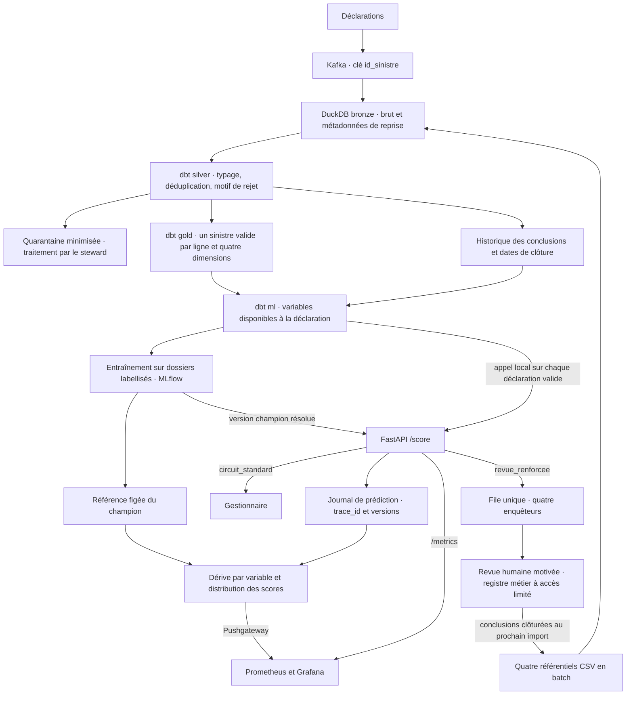

# Contre-proposition d’architecture MAA

**Avis de revue L0.** Conserver Kafka, DuckDB, dbt, MLflow, FastAPI et la pile de supervision du kit. Pour environ 4 000 déclarations par an et quatre enquêteurs, le chantier prioritaire consiste à relier une déclaration à son premier score, puis à la personne qui traite le dossier. Cette cible complète [l’architecture initiale](architecture.md) et reprend les [critères de succès](succes.md). Les contrôles ci-dessous restent à démontrer aux lots concernés.

## Écarts qui changent le comportement

| Priorité | Constat dans la version initiale | Conséquence et correction proposée |
|---|---|---|
| Haute | Seul le modèle entre dans l’API, lignes 64–71. | Une déclaration peut être en gold et ne jamais obtenir de score. Un traitement local appelle `/score` après publication des variables validées par dbt. Le journal conserve l’heure d’ingestion et celle du premier score pour mesurer le délai réel. |
| Haute | Les deux orientations aboutissent aux quatre enquêteurs, ligne 72. | Une lecture littérale envoie toute la production en enquête. Le gestionnaire reçoit le circuit standard. Une orientation renforcée ouvre une seule entrée de file par sinistre, même après rejeu. |
| Haute | Le contrôle d’accès est inscrit sur Qdrant, lignes 36–40. La recherche et l’origine du rôle sont invisibles. | Un gestionnaire pourrait recevoir un article interne si un appel oublie le filtre. Un seul point de recherche local déduit le périmètre de l’identité vérifiée, applique le filtre à la requête Qdrant et transmet les seuls passages autorisés à Ollama. |
| Haute | Le journal mentionne « features, score, version », ligne 46. La référence de données et les variables autorisées sont indéterminées. | Deux prédictions sous le même modèle peuvent provenir de données différentes. Tracer version effective du modèle, version des données, version du seuil et variables de suivi autorisées. Le projet dbt fournit par ailleurs un sel de repli littéral versionné. Exiger un sel local et vérifier son absence des artefacts diffusés avant d’utiliser la pseudonymisation. |
| Moyenne | Bronze est annoncé idempotent, ligne 101, et la déduplication est attribuée à silver, ligne 120. | Relancer après un arrêt propre, relire après une panne et republier les déclarations sont trois essais distincts. Les résultats attendus figurent ci-dessous. |
| Moyenne | La similarité part de gold, sans chemin explicite depuis les conclusions datées. Le rapport de dérive reçoit uniquement le journal courant, lignes 68–70. | Un dossier ancien peut bénéficier d’une enquête clôturée plus tard. Un changement de distribution peut aussi être attribué à tort au trafic si la référence change. Dater les conclusions disponibles et figer la référence du modèle servi. |

## Parcours cible pour la démonstration

**Scoring.** Pour le TP, un appelant local lit les nouvelles lignes valides après chaque lot dbt réussi et envoie à FastAPI les variables attendues par le modèle. L’entraînement et l’appelant partagent la même définition des variables. Le modèle et son seuil sont chargés ensemble. Un échec de l’API laisse le dossier à reprendre. Une relance retrouve le premier score et conserve l’entrée de file existante. La cadence des lots dépend de l’objectif de fraîcheur à convenir au L3. Les 48 h de revue commencent à l’entrée en file.

**Données et modèle.** La table ML conserve le label nullable et les colonnes `_audit_*` pour leurs usages dédiés. L’API et le modèle acceptent une liste explicite de variables. Un dossier sans conclusion peut recevoir un score et reste exclu de l’entraînement supervisé. Pour la similarité L6, comparer la description à celles d’autres dossiers dont la fraude était déjà confirmée avant la déclaration évaluée. Pour le label d’entraînement, utiliser les conclusions disponibles à la date de coupure. Comparer deux algorithmes au score de règles sur les mêmes périodes, puis comparer avec et sans similarité. Ajuster le seuil sur la validation et réserver le test chronologique à la mesure finale. Conserver janvier 2026 exclusivement pour L8.

**Décision et traces.** Le journal technique associe le `trace_id`, les versions et les valeurs de suivi minimisées au score. Exclure noms, coordonnées, texte libre brut et attributs d’audit des journaux d’exécution. La liaison au dossier, l’identité de la personne habilitée, son motif et les heures de mise en file et de première revue relèvent du registre métier à accès limité. Tout refus d’indemnisation doit y avoir un auteur humain. Les trois facteurs qui expliquent une revue renforcée accompagnent le dossier.

**Assistant documentaire L6.** Indexer localement les conditions générales par article avec source, version et classe d’accès. Réserver les passages du guide au rôle `anti_fraude` dès la recherche. Les intitulés de rôle saisis par un utilisateur ne donnent aucun droit. Ollama cite les articles autorisés ou répond « je ne sais pas ». La recherche documentaire et le calcul de similarité des sinistres ont des corpus et des finalités distincts.

## Ce que l’équipe doit pouvoir prouver

| Lot | Essai de réception proposé |
|---|---|
| L1–L2 | Sur le jeu initial, obtenir 12 080 événements en bronze. Relancer le même groupe sans republier donne zéro ajout. Simuler une reprise entre écriture et commit, puis une republication. Bronze garde la matière brute et ses métadonnées. Après dbt, chaque scénario conserve 11 883 sinistres valides uniques et 117 rejets. Le mode fichier produit le même schéma. Vérifier le grain après les jointures aux dimensions et l’absence d’identifiants directs, quarantaine comprise. |
| L3–L4 | Relier topic, bronze, tables dbt et version du modèle dans Marquez. Démontrer qu’une rupture de schéma de `fct_sinistres` fait échouer dbt et qu’une rupture du contrat producteur fait échouer GX. Documenter accès, rétention, responsables et fraîcheur. La CI exécute dbt et GX. La revue Ollama locale est évaluée sur les six défauts du kit. |
| L5–L7 | Pour une même déclaration, comparer les entrées d’entraînement et d’inférence à date. Tester un dossier sans label, un dossier rejeté et un appel répété. Retrouver le premier score, les versions et l’explication. Sur dix questions RAG, contrôler sources et abstentions, dont un essai de la même demande sous deux rôles. Vérifier les passages renvoyés avant génération. |
| L8–L9 | Distinguer le budget métier proposé de 10 % de sinistres valides uniques et l’alerte fournie à plus de 15 % des requêtes réussies. Un rejeu HTTP ne doit pas changer le premier indicateur. Comparer janvier 2026 à la référence figée avec PSI, KS et distribution des scores. Examiner les alertes avant toute décision de réentraînement. Évaluer le challenger en shadow puis en canary. Vérifier SHAP, les écarts Fairlearn, les effectifs et la couverture des labels avec le même recul par groupe. |

**Périmètre de la revue.** Documents de `docs/`, cinq supports du cours, README, consignes du dépôt, descriptif des fichiers bruts, deux conditions générales, gabarits de gouvernance et d’éthique, cas de revue IA. Recoupement avec le Makefile, le producteur, les squelettes des lots, dbt et les configurations de supervision. Le guide restreint, les exports et les données générées sont exclus. L’installation prévoit des profils séparés sur un poste de 8 Go. Dagster reste un bonus. Le kit contient déjà le producteur et les configurations de supervision. Le consommateur, le modèle et l’API sont encore des squelettes.

**Références.** [Cahier du TP, pp. 3–6](../supports/03_cahier_TP_fil_rouge.pdf) · [Grille, pp. 1–2](../supports/04_grille_evaluation.pdf) · [Fiche ingestion, p. 2](../supports/J1-2_ingestion.pdf) · [Installation](INSTALL.md) · [Projet dbt](../dbt/maa/dbt_project.yml) · [Alertes fournies](../monitoring/alerts.yml).
