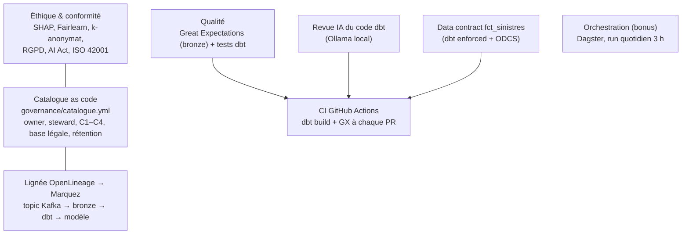

# Architecture cible — détection de fraude aux sinistres (MAA)

## Vue d'ensemble

```mermaid
flowchart LR
    %% ---------- Sources ----------
    subgraph SRC["Sources"]
        EVT["sinistres_events.jsonl<br/>(déclarations, flux)"]
        REF["assures / contrats /<br/>prestataires / enquetes .csv"]
        DOCS["data/docs/*.md<br/>(CG auto, habitation,<br/>guide anti-fraude)"]
    end

    %% ---------- Ingestion ----------
    subgraph ING["L1 — Ingestion"]
        PROD["producer.py"]
        KAFKA[["Kafka KRaft<br/>topic maa.sinistres.declares.v1<br/>(3 partitions, clé = id_sinistre)"]]
        CONS["consumer_to_lake.py<br/>(commit après écriture)"]
        LOADREF["load_referentiels.py<br/>(batch)"]
    end

    %% ---------- Lakehouse ----------
    subgraph LAKE["Lakehouse DuckDB"]
        BRONZE[("bronze.*<br/>brut, rejouable,<br/>rien n'est nettoyé")]
        SILVER[("silver.stg_*<br/>typé, dédupliqué,<br/>rejets marqués")]
        GOLD[("gold<br/>fct_sinistres, dim_*,<br/>sinistres_rejets")]
        ML[("ml.ml_features_sinistres<br/>features + label<br/>+ _audit_* (âge, zone, sexe)")]
    end

    %% ---------- ML ----------
    subgraph MOD["L5 — Modèle"]
        TRAIN["train.py<br/>(≥ 2 algos)"]
        MLFLOW[["MLflow<br/>expériences + registre<br/>alias champion"]]
    end

    %% ---------- RAG ----------
    subgraph RAG["L6 — RAG"]
        EMB["fastembed<br/>(embeddings CPU)"]
        QDRANT[("Qdrant<br/>contrôle d'accès<br/>profil anti_fraude")]
        OLLAMA[["Ollama<br/>qwen2.5:1.5b (local)"]]
    end

    %% ---------- Serving ----------
    subgraph SERV["L7 — Serving"]
        API["API FastAPI (Docker)<br/>/score · /health · /metrics"]
        LOG[("journal des prédictions<br/>features, score, version, trace_id")]
    end

    %% ---------- Monitoring ----------
    subgraph MON["L8 — Supervision"]
        PROM[["Prometheus<br/>+ Pushgateway"]]
        GRAF["Grafana<br/>(technique + métier)"]
        DRIFT["drift.py<br/>PSI / KS"]
    end

    %% ---------- Consommateurs ----------
    subgraph USERS["Humains"]
        GEST["Gestionnaires"]
        ENQ["4 enquêteurs<br/>(décision finale)"]
    end

    EVT --> PROD --> KAFKA --> CONS --> BRONZE
    REF --> LOADREF --> BRONZE
    BRONZE -->|dbt staging| SILVER -->|dbt marts| GOLD -->|dbt features| ML
    ML --> TRAIN --> MLFLOW -->|modèle champion| API
    DOCS --> EMB --> QDRANT
    QDRANT --> OLLAMA
    GOLD -. "feature similarité<br/>(fraudes confirmées à date)" .-> EMB
    EMB -. feature .-> ML
    API --> LOG --> DRIFT --> PROM
    API -->|/metrics| PROM --> GRAF
    API -->|"revue_renforcee /<br/>circuit_standard"| ENQ
    OLLAMA -->|réponses sourcées| GEST
    ENQ -. "conclusions d'enquête<br/>(nouveaux labels)" .-> REF
```

## Gouvernance transverse

## Couches et règles

| Couche | Contenu | Outil | Règle clé |
|---|---|---|---|
| bronze | données brutes + métadonnées d'ingestion (partition, offset, `ingested_at`, source) | Kafka, Python, DuckDB | aucun nettoyage, ingestion idempotente et rejouable |
| silver | `stg_*` typés, dédupliqués, rejets marqués (`motif_rejet`) | dbt (vues) | on marque au lieu de supprimer |
| gold | modèle en étoile `fct_sinistres` + `dim_*`, quarantaine `sinistres_rejets` | dbt (tables) | aucun identifiant direct (pseudonymisation salée) |
| ml | `ml_features_sinistres` : features, label, colonnes `_audit_*` | dbt (tables) | `_audit_*` servent uniquement à l'audit d'équité, jamais de features |

## Qui consomme quoi

| Consommateur | Utilise | Pour |
|---|---|---|
| Modèle (L5) | `ml.ml_features_sinistres` | entraînement |
| API de scoring (L7) | modèle champion MLflow | score + orientation de chaque déclaration |
| Enquêteurs | file `revue_renforcee` + explication SHAP | décider (l'humain décide toujours) |
| Gestionnaires | assistant RAG | questions sur les conditions générales, réponses sourcées |
| Équipe anti-fraude | RAG + guide interne (accès restreint) | appui aux enquêtes |
| Data / ML engineers | Grafana, alertes, rapport de dérive | supervision, décision de ré-entraînement |
| DPO / conformité | catalogue, registre RGPD, rapport d'éthique | contrôle de conformité |

## Points de vigilance

- **Livraison at-least-once** (Kafka) : des doublons sont possibles, la déduplication se fait en silver.
- **Label biaisé** : seuls les dossiers enquêtés sont labellisés (biais de sélection).
- **Fuite de données** : la feature de similarité ne doit utiliser que les fraudes confirmées *avant* la date du sinistre.
- **Données personnelles** : aucune donnée de `assures` ni de `enquetes` ne doit être envoyée à une IA hébergée ; seul le LLM local (Ollama) est autorisé.
