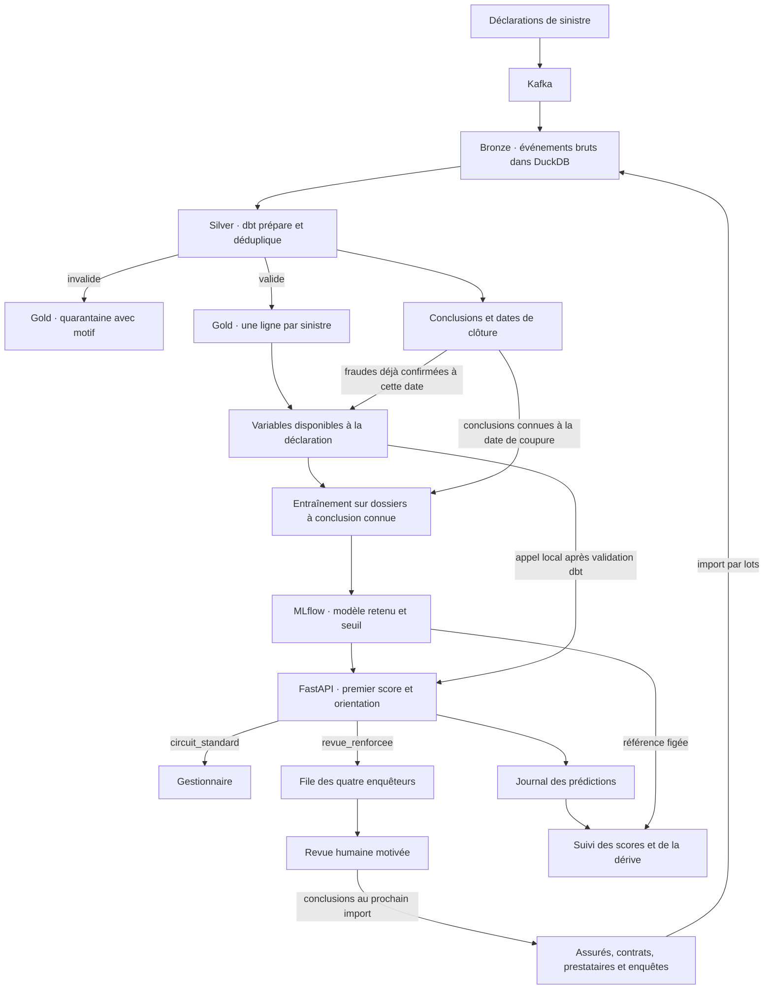

# Architecture cible de l’aide à la détection de fraude

La Mutuelle Alpine Assurances reçoit environ 4 000 déclarations de sinistre par an. Ses quatre enquêteurs doivent choisir quels dossiers examiner en priorité. Le système attribue un score à chaque déclaration valide, explique son orientation et permet de retrouver la décision humaine. Tout refus d’indemnisation doit être décidé et motivé par une personne habilitée.

Ce document décrit la cible du TP. Le kit fournit notamment le producteur Kafka et les configurations de supervision. Le consommateur, l’entraînement et le service de score restent à réaliser. Les résultats attendus ci-dessous serviront à la démonstration. [Cahier du TP](../supports/03_cahier_TP_fil_rouge.pdf) · [Critères de succès métier](succes.md)

## De la déclaration à la première revue

### Recevoir et préparer le dossier · L1–L2

Imaginons qu’un dégât des eaux soit déclaré deux fois après une interruption. La mutuelle doit pouvoir expliquer les deux transmissions et ouvrir un seul dossier. DuckDB conserve les données dans quatre couches, chacune répondant à une question.

| Couche | Question | Règle de traitement |
|---|---|---|
| Bronze | Qu’avons-nous reçu ? | Conserver l’événement brut, sa source, son heure d’ingestion et sa position dans Kafka (partition et offset). Importer aussi les quatre fichiers de référence. Ces données permettent de refaire les calculs. |
| Silver | Peut-on interpréter la déclaration ? | Les vues `stg_*` de dbt normalisent dates, types et montants, repèrent les doublons et marquent les anomalies avec `motif_rejet`. |
| Gold | Combien de sinistres valides avons-nous ? | `fct_sinistres` contient une ligne par sinistre valide, reliée à quatre tables de contexte (assuré, contrat, prestataire, date). C’est le modèle en étoile. Les rejets vont dans `sinistres_rejets` avec le minimum utile à leur correction. |
| ML (apprentissage automatique) | Que pouvait-on savoir au moment du score ? | `ml_features_sinistres` regroupe les variables de calcul, la conclusion d’enquête si elle existe et les colonnes `_audit_*` réservées à l’audit d’équité. Seules les variables de calcul autorisées entrent dans le modèle. |

Kafka répartit le flux `maa.sinistres.declares.v1` sur trois partitions avec `id_sinistre` comme clé. Le consommateur confirme sa position après l’écriture en bronze. Après un arrêt propre, il reprend au message suivant. Une panne entre écriture et confirmation peut faire relire la même position. Une republication crée une nouvelle position pour le même sinistre. Dans les deux cas, le dossier métier doit rester unique. Le mode local `--from-file` produit le même schéma bronze pour permettre la démonstration sans Kafka.

Pour les assurés, contrats, prestataires et enquêtes, le TP fournit quatre fichiers complets. Si une fraîcheur d’un jour suffit, on peut les importer ensemble chaque jour (traitement par lot, ou *batch*). Suivre chaque modification à la source (*Change Data Capture*, CDC) réduirait ce délai, mais demanderait un accès au journal de la base source et un connecteur à exploiter. Les exports du TP suffisent au traitement par lot.

Depuis la racine, `.venv/bin/python ingestion/load_referentiels.py` charge les quatre fichiers et affiche uniquement les effectifs. Les champs restent du texte pour conserver notamment les zéros en tête. L’empreinte du contenu (`_source_sha256`) identifie chaque version dans sa table. Recharger un fichier identique conserve les effectifs. Un fichier modifié ajoute une version complète. Pour comparer deux imports ou joindre ces données, il faut sélectionner une seule version par table. Si un des quatre fichiers est invalide, le lot entier est annulé.

### Apprendre sur le passé, orienter le dossier du jour · L5–L7

**Entraînement.** Une conclusion d’enquête connue constitue une étiquette, ou *label*. Seuls les dossiers dont la conclusion est disponible à la date de coupure servent à l’entraînement supervisé. L’équipe compare au moins deux algorithmes et un score fondé sur des règles, sur les mêmes périodes. Elle teste aussi l’apport de la ressemblance entre descriptions avec et sans cette variable. Pour un dossier de mars, la ressemblance maximale se calcule sur les autres fraudes confirmées avant sa déclaration ; une enquête clôturée en juin ne peut pas l’éclairer rétrospectivement.

**Choix du modèle.** L’équipe ajuste le seuil de revue sur une période de validation, puis mesure le résultat sur une période ultérieure réservée au test. MLflow conserve les essais, la provenance des données et la version retenue sous l’alias `champion`. Janvier 2026 reste réservé à l’exercice de dérive. Seuls les dossiers enquêtés ayant une conclusion connue permettent de mesurer les erreurs : les résultats dépendent donc aussi des choix passés des enquêteurs.

**Premier score.** Après chaque lot dbt réussi, un traitement local envoie les nouvelles déclarations valides à l’interface de calcul `/score` de FastAPI. Ce traitement utilise la même définition des variables que l’entraînement. Le service tourne dans un conteneur Docker, valide les entrées avec Pydantic et charge ensemble le modèle et son seuil. Un dossier sans conclusion peut ainsi recevoir un score. Un échec laisse le dossier à reprendre ; une répétition de l’appel retrouve son premier score et, le cas échéant, son unique entrée en file. La cadence des lots dépend du délai maximal entre réception et score, à fixer au L3.

**Traitement humain.** Le gestionnaire reçoit le circuit standard. En revue renforcée, l’enquêteur reçoit les trois principaux facteurs qui expliquent le score, exprimés en langage métier avec la méthode d’attribution SHAP. Le journal technique relie le score à un identifiant de trace (`trace_id`), aux heures d’ingestion et de premier score, aux versions effectives du modèle, des données et du seuil, ainsi qu’aux seules variables nécessaires au suivi. Le registre métier à accès limité relie le dossier, l’entrée en file, la première revue, l’auteur et le motif de la décision. Les conclusions clôturées reviennent au prochain import.

## Comment un gestionnaire retrouve un article · L6

Pour répondre à une question sur une garantie, l’assistant recherche d’abord des extraits, puis rédige une réponse à partir de ces extraits. Cette méthode s’appelle la génération augmentée par recherche (*RAG*). Les conditions générales et le guide interne sont découpés par article. FastEmbed représente chaque passage par un vecteur numérique pour rechercher par sens. Qdrant indexe ces vecteurs avec la source, la version et la classe d’accès.

Le service local détermine le rôle à partir de l’identité vérifiée et filtre la recherche dans Qdrant. Seul le rôle `anti_fraude` peut retrouver des passages du guide interne. Ollama reçoit les extraits autorisés, cite les articles ou répond « je ne sais pas » si les sources sont insuffisantes. Cet index documentaire est distinct de l’historique de sinistres utilisé pour la ressemblance entre dossiers. Le guide reste local. Aucune ligne de `bronze.assures` ou de `bronze.enquetes` ne sort du poste vers un outil d’IA.

## Qui contrôle les données et le service · L3–L4, L8–L9

| Responsabilité | Choix et justification |
|---|---|
| Qualité et provenance | Great Expectations vérifie le contrat du producteur à l’entrée. dbt contrôle les transformations et impose le schéma de `fct_sinistres`. Le contrat écrit précise aussi les règles de qualité, la fraîcheur exigée et la politique de changement. Les deux contrôles s’exécutent à chaque proposition de modification dans GitHub Actions. OpenLineage enregistre les étapes et Marquez montre le parcours du flux Kafka jusqu’à la version du modèle. Ollama aide à relire localement les changements dbt. |
| Accès et confidentialité | Le catalogue précise responsables, rôles, classes de sensibilité C1 à C4, base légale et durée de conservation. Gold et ML excluent les identifiants directs, y compris en quarantaine. La pseudonymisation exige un sel secret fourni localement ; la valeur de repli versionnée du kit est à retirer avant usage. Les journaux techniques excluent les données personnelles, le texte libre brut et les attributs d’audit. |
| Charge et délais | L’objectif proposé est d’orienter au plus **10 % des sinistres valides uniques**, avec une première revue sous **48 h après l’entrée en file**. Les enquêteurs doivent confirmer la capacité en pointe et préciser si ces heures sont ouvrées ou calendaires. L’alerte fournie porte sur **plus de 15 % des requêtes réussies** : elle utilise une fenêtre d’une heure et le taux doit dépasser ce seuil pendant 30 minutes. Rejouer un appel peut changer cette mesure technique sans créer de travail supplémentaire. |
| Supervision et dérive | FastAPI expose `/health` et `/metrics`. Prometheus collecte les mesures et Grafana affiche débit, erreurs, temps de réponse et indicateurs métier. Le délai jusqu’au premier score inclut aussi l’attente du lot. Pour janvier 2026, l’équipe compare variables et scores à la référence figée du modèle servi. L’indice de stabilité de population (PSI) et le test de Kolmogorov–Smirnov (KS) aident à repérer les changements. Le rapport transmet ses mesures via Pushgateway. Un écart déclenche une analyse humaine avant tout réentraînement. |
| Équité et conformité | Avec Fairlearn, l’équipe compare taux de revue, faux positifs et rappel selon l’âge, la zone et le sexe, à recul comparable. Elle publie les effectifs et la part des dossiers à conclusion connue, recherche les variables qui reflètent indirectement ces attributs et teste une atténuation. Le délégué à la protection des données et l’équipe conformité consultent le catalogue, le registre des traitements et le rapport d’éthique, qui documente le risque de réidentification (k-anonymat), le règlement général sur la protection des données, le règlement européen sur l’intelligence artificielle et la norme ISO/IEC 42001. |

La pile fonctionne localement avec les profils du kit. Dagster, proposé en bonus pour programmer les traitements, reste facultatif. [Catalogue](../governance/catalogue.yml) · [Installation](INSTALL.md) · [Alertes fournies](../monitoring/alerts.yml) · [Rapport d’éthique à compléter](../ethics/rapport_ethique_TEMPLATE.md)

## Preuves attendues en démonstration

| Lots | Essai et observation attendue |
|---|---|
| L1–L2 | Charger le jeu initial : 12 080 événements en bronze. Relancer le consommateur après un arrêt propre : zéro ajout. Tester aussi la reprise après panne et la republication. Après transformation et jointures, retrouver dans chaque cas 11 883 sinistres valides uniques et 117 rejets. Vérifier le schéma du mode fichier et l’absence d’identifiants directs en gold et en ML. |
| L3–L4 | Suivre un flux jusqu’au modèle dans Marquez. Renommer une colonne contractuelle doit faire échouer dbt. Enfreindre le contrat d’entrée doit faire échouer Great Expectations. Évaluer la revue locale sur les six défauts du kit. |
| L5–L7 | Comparer les entrées d’entraînement et de calcul à date identique. Rejouer notre déclaration valide orientée en revue : retrouver le même premier score, ses versions, son explication et une seule entrée en file. Vérifier aussi un dossier sans conclusion et un dossier rejeté. Sur dix questions documentaires, vérifier citations et abstentions ; poser la même question sous deux rôles et inspecter les passages renvoyés avant rédaction. |
| L8–L9 | Démontrer au moins trois alertes, dont une métier. Expliquer les changements de janvier par rapport à la référence du modèle. Évaluer un modèle candidat en parallèle du modèle servi (*shadow*), puis sur une fraction limitée du trafic (*canary*). Présenter deux explications individuelles, les écarts entre groupes et l’effet de la mesure d’atténuation. |

[Grille d’évaluation et déroulé de la soutenance](../supports/04_grille_evaluation.pdf)
